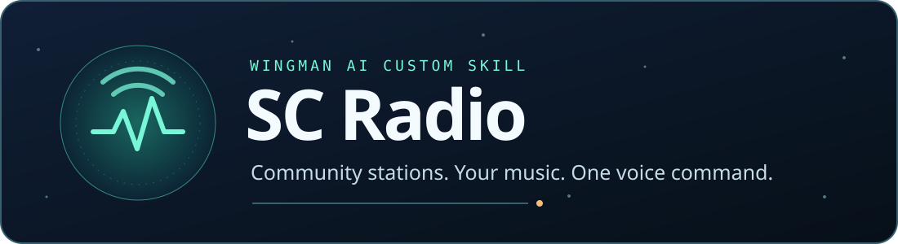

# SC Radio for Wingman

Tune in to **Star Citizen Radio**, **The Base** or **HCN Radio** by voice. Add a public station or podcast, or let Wingman shuffle music you’ve selected from your Audio Library. SC Radio controls its own audio volume.

**[Download SC Radio for Wingman](https://raw.githubusercontent.com/Fowlplaychiken/SC-Radio-Wingman/NewRepo/downloads/sc_radio-0.2.5.zip)** · Windows tested · Wingman custom skills API v3



## Install

1. Extract the `sc_radio` folder from the ZIP into Wingman’s **custom skills** folder. On Windows, paste `%APPDATA%\ShipBit\WingmanAI\custom_skills` into File Explorer. You should see `sc_radio\default_config.yaml` inside.
2. SC Radio uses **mpv** to play audio. On Windows x64, right-click `setup-player.ps1` in the skill folder and choose **Run with PowerShell**. Windows 11 may put this under **Show more options**. The helper finds an existing player or downloads and verifies the pinned release. If you already have mpv, you can select it under **mpv executable**. [Official mpv downloads](https://mpv.io/installation/)
3. Reopen Wingman, add **SC Radio** to your profile, and say **“Tune in to Star Citizen Radio.”** The three presets are ready immediately.

## What to say

| To… | Say… |
| --- | --- |
| Find a station | “List my radio stations.” / “Tune in to The Base.” |
| Choose music | “Play the album *[album]* by *[artist]*.” / “Shuffle my music.” |
| Change the queue | “Play *[song]* next.” / “What’s in my queue?” |
| Control playback | “What’s playing?” / “Next track.” / “Repeat this song.” |
| Adjust the sound | “Set music volume to 15%.” / “Mute the music.” / “Stop the music.” |

For personal music, add MP3 or WAV files to Wingman’s **Audio Library**, then select them under **SC Radio → Personal playlist**. If two songs share a title, give the artist or album too. Untagged songs work by filename. Queuing, track navigation and repeat work with your music. A live station may return to its current broadcast position after a pause.

## Add a station or podcast

Open **Station list** in the skill settings. Add one line per source, give each a unique name, and save. Then say **“Play My podcast”** or use the name you chose.

```text
Star Citizen Radio = https://streaming.live365.com/a31263
My station = https://radio.example.org/live.mp3
My podcast = rss:https://podcast.example.org/feed.xml
```

Replace the example addresses with the broadcaster’s HTTPS audio stream or the publisher’s RSS feed. For a podcast, SC Radio looks for a playable recent episode, using the publication date when available. [Star Citizen Radio on Live365](https://live365.com/station/Star-Citizen-Radio-a31263) · [Preset sources](NOTICE.md)

<details>
<summary><strong>Listen to public YouTube, Twitch or PulseNet</strong></summary>

Install **yt-dlp** and a supported JavaScript runtime, put yt-dlp on your PATH, and restart Wingman. In **Station list**, save a public YouTube video, playlist or live URL, or a public Twitch channel or VOD URL, using the same `Name = URL` format. [yt-dlp installation](https://github.com/yt-dlp/yt-dlp#installation) · [Supported JavaScript runtimes](https://github.com/yt-dlp/yt-dlp/wiki/EJS)

For PulseNet’s additional presets, turn on **PulseNet (YouTube)** and say **“Tune in to PulseNet”** or **“Play Crosswind.”** The running order follows the publisher’s playlists. Broadcasts depend on the source being available. [PulseNet playlists](https://www.youtube.com/@PulseNetLIVE/playlists)

</details>

## If playback is silent

- **No player found?** Run the Windows helper or select your installed mpv executable. If the helper reports a checksum failure, remove its cached player directory at `%LOCALAPPDATA%\SC Radio\mpv-0.42.0-x64` and rerun setup.
- **Only one source fails?** Try another preset. Check the station URL, RSS feed, or whether the broadcast is live. For YouTube and Twitch, check yt-dlp is on PATH.
- **No sound from any source?** Check the operating system’s default audio output and SC Radio’s volume. Ask SC Radio to stop before trying again.
- **Wingman picks another music skill?** Say **“Use SC Radio”** at the start of the request.

**Updating:** Stop playback, quit Wingman, and move the old `sc_radio` folder outside `custom_skills` before installing the new one. Your saved stations and music selection belong to your Wingman profile. To uninstall, stop playback and remove the skill from your profile and custom skills folder. Your player and Audio Library stay on your computer. [License](LICENSE)
