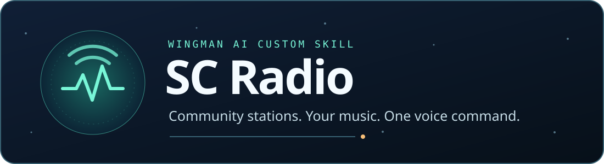

<p align="center">
  
</p>

# SC Radio

Play community radio and music from your own library through Wingman AI. Tune in to **The Base** or **HCN Radio**, ask for an album, or shuffle your playlist. Audio plays directly through mpv, with Wingman’s standard custom-skill interface.

**v0.2.4** · **Wingman custom skill API v3** · **Tested on Windows** · [GPL-3.0](LICENSE)

**[Download the install ZIP](https://raw.githubusercontent.com/Fowlplaychiken/SC-Radio-Wingman/NewRepo/downloads/sc_radio-0.2.4.zip)** · [Quick start](#install) · [What to say](#use) · [Add stations or music](#configure-stations-and-songs)

| Live radio and podcasts | Your music | Playback controls |
| --- | --- | --- |
| The Base and HCN Radio come preconfigured. Add direct streams, public RSS podcasts, or public YouTube and Twitch links. | Play selected MP3 and WAV files by title, artist, album, or genre. | Shuffle, queue, skip, repeat, mute, and adjust music volume by voice. |

## Install

1. [Download SC Radio](https://raw.githubusercontent.com/Fowlplaychiken/SC-Radio-Wingman/NewRepo/downloads/sc_radio-0.2.4.zip) and extract it. On Windows, paste `%APPDATA%\ShipBit\WingmanAI\custom_skills` into File Explorer’s address bar and copy the extracted `sc_radio` folder there. The final path should end in `custom_skills\sc_radio\default_config.yaml`. On other platforms, use your Wingman installation’s custom skills folder.
2. On Windows x64, open `sc_radio`, right-click `setup-player.ps1`, and choose **Run with PowerShell**. On Windows 11, the command may be under **Show more options**. Setup reuses mpv from a recognized location or downloads and checks the official release if needed. You can skip this step if mpv is already installed in a recognized location. Setup needs no administrator privileges.
3. Restart Wingman and add **SC Radio** to your profile. Leave **mpv executable** blank for automatic detection. For a custom install location or another platform without a detected player, install mpv from the [official installation page](https://mpv.io/installation/) and enter its full executable path. Windows **Copy as path** works with or without quotes.
4. Ask **“Tune in to The Base”** or **“Play HCN Radio.”** Leave **Station list** at its defaults unless you want to change it.

The Windows helper downloads mpv directly from its publisher on demand and checks the archive and player against pinned SHA-256 hashes. Wingman only launches the player for playback. See the [player provenance](NOTICE.md#mpv-player).

### Upgrade an existing installation

1. Stop SC Radio playback and quit Wingman.
2. Move your existing `sc_radio` folder outside Wingman’s custom skills folder as a backup. Install the new `sc_radio` folder in its place using step 1 above.
3. Open Wingman, check **SC Radio** is enabled in the same profile, and ask **“List my radio stations.”** Your station list and selected songs are saved in the Wingman profile. The player setup only needs to run again if Wingman can no longer find mpv.

For your own music, add MP3 or WAV files to Wingman’s **Audio Library**, select them under **SC Radio → Personal playlist**, then ask **“Shuffle my music.”** You can leave the playlist empty if you only use radio.

SC Radio uses the operating system's default audio output. Its initial music
volume is 50%; change it by voice or with the volume command. The player
runs with video and user mpv scripts disabled. Select only an `mpv` executable
you trust.

### PulseNet (optional)

1. Install [yt-dlp](https://github.com/yt-dlp/yt-dlp#installation) and a
   [supported version of Deno or Node.js](https://github.com/yt-dlp/yt-dlp/wiki/EJS).
   Put yt-dlp on PATH and restart Wingman so it sees the updated PATH.
2. Turn on **PulseNet (YouTube)** in the SC Radio skill settings.
3. Ask **“Tune in to PulseNet”** for the 24/7 broadcast or **“Play Crosswind”**
   for the genre station. To combine stations, say **“Play Crosswind, then
   NovaBeat, as a PulseNet mix.”** SC Radio plays the playlists in the order
   you give, preserving the published track, DJ segment, and bumper order.
   All playback uses the existing audio player without a browser or video window.

SC Radio checks [PulseNet's published station definitions](https://github.com/Diftic/PulseNet-Player/blob/master/src/Renderer/stations.js)
and the [official channel's Playlists tab](https://www.youtube.com/@PulseNetLIVE/playlists)
when listing stations or tuning a PulseNet station. It caches the result and
adds public genre playlists as the publisher lists them. The live station
and your saved stations remain available if the list cannot refresh.
The live source depends on YouTube availability. Use only where permitted by
the [YouTube terms](https://www.youtube.com/t/terms). The yt-dlp integration is
optional and uses your own installation.

## Use

Examples you can say or enter as requests:

```text
List my radio stations.
Tune in to The Base.
Play HCN Radio.
What songs, artists, or albums are in my library?
Play <song title> by <artist>.
Put on some <artist>.
Play the album <album> by <artist>.
Play some <genre>.
Shuffle my music.
Play <song title> next.      Add <song title> to the end of the queue.
What's in my queue?          What's playing?
Pause the music.             Resume.                    Stop the music.
Next track.                  Previous track.            Start this song over.
Repeat this song.            Repeat the playlist.       Turn repeat off.
Make the music louder.       Set music volume to 15%.   Mute or unmute the music.
```

Wingman interprets the request from ordinary phrasing. If a profile also uses
another radio or music skill, give it a short preference such as “Use SC Radio
for broadcast stations and personal library music. Use the game radio for
explicit ship controls.” Name SC Radio explicitly to disambiguate a request.

The skill exposes five typed Wingman tools:

- `sc_radio_list` lists stations, songs, artists, albums, or genres.
- `sc_radio_play` plays a station, song, artist, album, genre, or playlist. Music collections can start in order or shuffled.
- `sc_radio_queue` shows the queue or adds a selected song while personal music plays.
- `sc_radio_control` handles playback, next and previous, repeat, mute and status.
- `sc_radio_volume` sets music volume or changes it by a signed percentage-point amount.

Song titles, artist and album names, genres and album track order come from
embedded file tags. Untagged files are playable by filename. If two songs
share a title, give the artist or album as well. The skill controls its own
music player and leaves Wingman's speech volume and audio-device settings alone.
Disabling the skill ends its player session. Some transport controls apply
only to local music.

## Configure stations and songs

Edit **Station list** in the skill settings. Add one source per line, using a
unique name and one of the supported forms:

```text
The Base = https://listen.thebase.sc
HCN Radio = https://hcnradio.ddns.me/stream/1/
My station = https://radio.example.org/live.mp3
My podcast = rss:https://podcast.example.org/feed.xml
My video station = https://www.youtube.com/@space-radio/live
My Twitch stream = https://www.twitch.tv/example
My Twitch replay = https://www.twitch.tv/videos/123456789
```

Save the list, then ask **“Play My podcast”** or **“Tune in to My Twitch stream.”**
Ask for more stations to page through long lists.

- **Direct radio.** Use the broadcaster’s public HTTPS audio stream. See the [preset feed sources](NOTICE.md).
- **Podcasts.** Use the publisher’s public RSS feed with the `rss:` prefix. When you tune in, SC Radio reads up to 1 MB of feed data and checks recent items for a public HTTPS audio enclosure. It prefers the latest publication date when the feed provides dates.
- **YouTube and Twitch.** Save a public YouTube video, playlist or live page, or a public Twitch channel or VOD. Set up yt-dlp and its JavaScript runtime as described under [PulseNet](#pulsenet-optional). The PulseNet switch controls only the PulseNet presets.

Use links where permitted by the source’s terms. Live streams may resume at
the current broadcast position after pausing or reconnecting.

For personal music, add files to Wingman's Audio Library and select them in
the **Personal playlist** setting. SC Radio uses only selected MP3 and WAV
files that remain inside that library. It plays audio files you supply. The release ZIP contains the skill and its tag reader.

## Troubleshooting

- **mpv cannot be found:** On Windows x64, run `setup-player.ps1` and leave the player setting blank. If your system blocks scripts, install mpv separately and select the full executable path.
- **The downloaded player failed verification:** Remove `%LOCALAPPDATA%\SC Radio\mpv-0.42.0-x64` and rerun `setup-player.ps1`.
- **Audio does not start:** Confirm mpv opens on your system, the selected operating-system audio output works, and the stream or file is reachable. Try another station or a selected local song to narrow down whether the issue is the feed or player.
- **A station fails to open.** Check its saved URL and source type against [Configure stations and songs](#configure-stations-and-songs). For YouTube and Twitch, also verify that yt-dlp is on PATH and the source is public and online.
- **A song is missing:** Confirm it is in Wingman's Audio Library, selected in SC Radio's **Personal playlist** setting, and is an MP3 or WAV file. Then ask Wingman to list the available sources.
- **Pause, status, or volume does not respond:** Ask SC Radio to stop, then start the source again. If Wingman was forcibly terminated, check whether its mpv process is still playing before starting another SC Radio session.
- **Wingman does not show the skill:** Confirm the extracted folder is named `sc_radio`, is inside the custom skills directory, and restart Wingman. Check the Wingman custom skill API version and skill-load logs if the issue remains.

## Remove

Stop playback, remove SC Radio from the Wingman profile, delete the extracted
`sc_radio` folder from the custom skills directory, and restart Wingman. This
does not uninstall mpv or remove music from Wingman's Audio Library; those
remain under your control.

## Source and contributions

This public skill is maintained in the Star Citizen Computer project as an
optional Wingman integration. Its implementation uses Wingman's public custom
skill API v3 and Audio Library picker. The skill does not depend on the Star
Citizen Computer application, game files, game process, or another project
service at runtime. The source and build recipe are included in this
repository; the install ZIP contains the skill and its bundled tag reader.
Add your own music through Wingman’s Audio Library. See [`NOTICE.md`](NOTICE.md) for station and source
provenance, and [`LICENSE`](LICENSE) for redistribution terms.

Bug reports and contributions should include the SC Radio release version,
operating system, Wingman build, mpv version, and the relevant non-secret
error text. Do not attach personal music, recordings, credentials, or private
library paths. Wingman maintainers can evaluate this as a custom module or
reuse its station and playlist controls in Core. The skill uses the supported
custom-skill interface and patches no Core files.

### Build and test

Use Python 3.11 or newer for development. Wingman supplies Python when running
the skill. To run the tests and build an install ZIP from a standalone checkout:

```shell
python -m pip install pytest PyYAML
python -m pytest -q
python scripts/package.py sc_radio-0.2.4.zip
```

The test suite uses inert Wingman and player fixtures. Live station playback
also requires the broadcaster and your audio output to be available.

For each release, update the install and upgrade steps, supported sources and
examples here alongside any behavior change. Match the README version and ZIP
links to `default_config.yaml`, then verify the published ZIP and checksum.
